 

---

I lead engineering on **[Slike](https://sli.ke)**, the video platform at **Times Internet**: **live streaming**, **players**,
**transcoding** and **ad tech** for newsrooms like TOI and NBT, built to hold up for **millions of viewers**.

Lately I spend my evenings on **AI agents and voice**. I'm building an assistant that does real work on my own computer,
and open-sourcing the pieces as I go.

<table>
<tr>
<td width="33%" valign="top">

### 🎬 Video at scale
Live and VOD pipelines, RTMP to HLS, DRM, players and failure recovery in production.

</td>
<td width="33%" valign="top">

### 🤖 AI agents
Claude-powered assistants and MCP tools that act safely: approvals, sandboxes, guards in code.

</td>
<td width="33%" valign="top">

### 🧱 Systems
Go and Python services on Kafka and Elasticsearch, monitored and recovering on their own.

</td>
</tr>
</table>

## 🎤 Building now: Alfred

**Your own voice assistant that runs on your computer.** Speech stays **on-device** (Whisper in, Kokoro out),
**Claude** does the thinking, and it handles **Gmail, Calendar and background coding tasks** while you talk to it from
**your phone**. Anything that sends, deletes or spends waits for your spoken **yes**.

**[⭐ Alfred on GitHub](https://github.com/anilkumarmeena/alfred)** &nbsp;·&nbsp;
**[📱 iOS & Android app](https://github.com/anilkumarmeena/alfred-app)** &nbsp;·&nbsp;
**[🚀 Setup guide](https://github.com/anilkumarmeena/alfred/blob/master/docs/setup.md)**

## 🧰 Open source

<table>
<tr>
<td width="50%" valign="top">

**[🧰 AI Armory](https://github.com/anilkumarmeena/ai-armory)** 
MCP tool sets in plain Python: Google Workspace and Mac control, for the Claude Agent SDK or any MCP client.

</td>
<td width="50%" valign="top">

**[📱 Alfred app](https://github.com/anilkumarmeena/alfred-app)** 
Capacitor app with native LiveKit audio that **keeps listening with the screen locked**.

</td>
</tr>
<tr>
<td width="50%" valign="top">

**[🧭 AI Agent Skills](https://github.com/anilkumarmeena/ai-agent-skills)** 
Plan-mode and safe-execution skills for coding agents: questions and approval before changes.

</td>
<td width="50%" valign="top">

**[🎞️ VTTKit](https://github.com/anilkumarmeena/vttkit)** 
Download, parse, merge and fix WebVTT subtitles, with YouTube and HLS live support.

</td>
</tr>
<tr>
<td width="50%" valign="top">

**[⏱️ EpochLens](https://github.com/anilkumarmeena/epochlens)** 
Chrome extension that turns Unix timestamps on any page into readable dates.

</td>
<td width="50%" valign="top">

**[📡 MediaVue](https://github.com/anilkumarmeena/mediavue)** 
Chrome extension that finds video, audio and HLS/DASH manifests on any page.

</td>
</tr>
</table>

## 🎬 At work

| | Project | Impact |
|:-:|---|---|
| 📺 | **Webstudio** — TV-style live broadcasts from a laptop or phone | **$200K+ a year** saved vs satellite |
| 🤖 | **Article-to-video** — AI turns newsroom articles into videos | **40% more** video content |
| ▶️ | **Cleo Player** — live, simulive and VOD with DRM and subtitles | **50% lower** delivery cost |
| 🩺 | **Central monitoring** — health checks with automatic recovery | **$50K a year** saved |
| 📦 | **Media engine & asset management** — RTMP in, transcode, HLS out | **50% faster** processing |

<b>🏆 Recognition at Times Internet</b>

 

| Year | Award |
|---|---|
| 2023 | 🥇 **Hack and Hustle 4.0** — company-wide hackathon winner |
| 2023 | ⭐ **Aspire Award** — performance |
| 2022 | ⭐ **Aspire Award** — performance |
| 2021 | 🐯 **Tiger Award** — technical excellence |

## 🔧 Tech I use

  
   
  

## 📫 Say hello

Working on **video, voice or AI agents**? Want to try **Alfred** or contribute? Reach out on
**[LinkedIn](https://www.linkedin.com/in/anil98meena)** or **[email](mailto:anil98meena@gmail.com)**, or open a
**[discussion on Alfred](https://github.com/anilkumarmeena/alfred/discussions)**.

---

Built with Go, Python and a lot of FFmpeg · Noida, India

